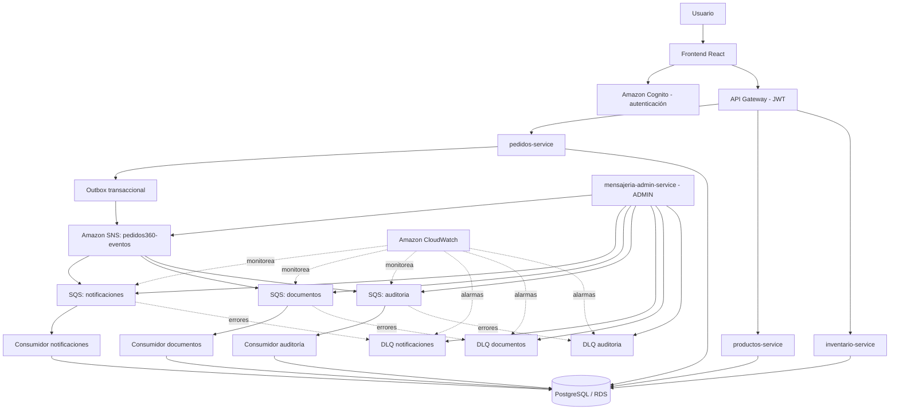

# Pedidos360 — Evaluación Parcial 2

**Desarrollo Cloud Native I (DSY1107) · Huamán y Mella · Octubre de 2026**

Pedidos360 es una aplicación de gestión de pedidos de zapatillas desarrollada con **React, Spring Boot y servicios de AWS**. En la Evaluación Parcial 2 (EP2) se incorpora **mensajería asíncrona** para que la creación de pedidos desencadene tareas de notificación, documentación y auditoría sin obligar al usuario a esperar por esos procesos.

El proyecto reúne el frontend, los microservicios, la configuración de infraestructura y la documentación en un único repositorio.

## Arquitectura



> El diagrama es conceptual. Las políticas de entrega y las suscripciones se definen en la infraestructura; los consumidores consultan SQS con *long polling* mediante el SDK de AWS.

## Componentes

| Directorio | Tecnología | Responsabilidad |
|---|---|---|
| `frontend/` | React, TypeScript, Vite, Amplify | Inicio de sesión con Cognito e interfaz de la aplicación. |
| `pedidos-service/` | Java, Spring Boot | Gestión de pedidos y publicación de eventos SNS mediante outbox transaccional. |
| `productos-service/` | Java, Spring Boot | Catálogo y operaciones sobre productos. |
| `inventario-service/` | Java, Spring Boot | Stock y operaciones de inventario. |
| `consumidores-service/` | Java, Spring Boot, AWS SDK SQS | Consumo de notificaciones, documentos y auditoría; ACK, reintentos, DLQ e idempotencia. |
| `mensajeria-admin-service/` | Java, Spring Boot, AWS SDK | API REST administrativa de SNS, SQS, consumidores, DLQ y CloudWatch. |
| `infraestructura/` | AWS CloudFormation | Topología SNS, SQS, DLQ, suscripciones y alarmas. |
| `docs/` | Markdown | Plan de trabajo y documentación técnica. |

## Flujo de mensajería

1. El usuario realiza una operación de pedido desde el frontend autenticado con Cognito.
2. `pedidos-service` registra el pedido y el evento pendiente en un **outbox transaccional**.
3. El publicador del outbox envía el evento al tópico SNS `pedidos360-eventos`, incluyendo el atributo **`eventType`** para el filtrado.
4. SNS distribuye el evento a las colas que tienen suscripciones compatibles.
5. Los consumidores leen sus colas, ejecutan la tarea correspondiente y confirman con **ACK** (`DeleteMessage`) después del procesamiento correcto.
6. Ante errores recuperables, el mensaje se vuelve a intentar; los fallos definitivos se registran y derivan a la **DLQ**, desde la cual el administrador puede consultar o reprocesar mensajes.

### Fanout y filtros de suscripción

| Cola principal | Eventos configurados | Tarea |
|---|---|---|
| `pedidos360-notificaciones` | `PEDIDO_CREADO`, `PEDIDO_CANCELADO` | Procesar la notificación del evento (simulación de envío). |
| `pedidos360-documentos` | `PEDIDO_CREADO` | Registrar la generación del comprobante/documento. |
| `pedidos360-auditoria` | `PEDIDO_CREADO`, `PEDIDO_CANCELADO`, `PRODUCTO_ACTUALIZADO` | Registrar trazabilidad de eventos. |

Un evento `PEDIDO_CREADO` se entrega a las **tres colas** (*fanout*). En cambio, `PRODUCTO_ACTUALIZADO` se enruta solo a auditoría mediante el **filtro de suscripción**. El filtro se basa en el atributo SNS `eventType` de tipo `String`, no únicamente en el campo del cuerpo JSON.

### Fiabilidad y tratamiento de errores

- **ACK explícito:** se elimina el mensaje de SQS solo después de confirmar el procesamiento; los duplicados reconocidos también se confirman.
- **Idempotencia:** una tabla de eventos procesados en PostgreSQL evita repetir efectos cuando SQS entrega nuevamente un evento.
- **Error recuperable:** no se confirma el mensaje; se ajusta su visibilidad para permitir otro intento.
- **Redrive Policy:** después del máximo de recepciones configurado, SQS puede enviar el mensaje a su DLQ.
- **Error definitivo:** el consumidor registra el motivo y envía el mensaje a la DLQ antes de confirmar el original.
- **Disponibilidad:** dos instancias del mismo servicio consumidor pueden leer las mismas colas; si una se detiene, la otra continúa recibiendo trabajo.

Los consumidores se organizan por dominio usando la anotación **personalizada `@EscuchaSqs`**. `RegistroConsumidores` encuentra esos procesadores y conecta la configuración de sus colas. La recepción se implementa con AWS SDK y *long polling*; `@EscuchaSqs` **no es la anotación oficial `@SqsListener` de Spring Cloud AWS**.

## Parámetros AWS de mensajería

| Parámetro | Configuración del laboratorio | Justificación |
|---|---|---|
| Colas SQS principales | 3 (una por dominio) | Aislar trabajos y fallos. |
| Colas de mensajes fallidos (DLQ) | 3 (una por cola principal) | Conservar mensajes para diagnóstico y reproceso. |
| Retención de colas principales | 4 días | Tiempo para resolver interrupciones temporales. |
| Retención de DLQ | 14 días | Mayor margen para investigar errores. |
| Visibility timeout | 120 segundos | Evitar que otro consumidor procese inmediatamente un mensaje en curso. |
| Long polling | 20 segundos | Reducir consultas vacías a SQS. |
| `maxReceiveCount` | 3 | Limitar reintentos antes del traslado automático a DLQ. |
| Entrega SNS | `RawMessageDelivery=true` | Entregar a SQS el mensaje sin envoltura adicional de SNS. |
| CloudWatch | Métricas y alarmas de DLQ | Detectar acumulación y fallos de procesamiento. |

La topología está descrita en `infraestructura/mensajeria-cloudformation.yml` y fue utilizada en el entorno de **AWS Academy Learner Lab**.

## Administración y observabilidad

`mensajeria-admin-service` expone una API REST para administrar los recursos del proyecto. Los endpoints `/api/**` requieren autenticación con Cognito y permisos del grupo **`ADMIN`**; `/health` es público.

Las operaciones incluyen:

- **SNS:** listar, crear y eliminar tópicos; consultar, crear y eliminar suscripciones.
- **SQS:** listar y consultar colas; crear una cola con su DLQ y eliminar recursos con confirmación explícita.
- **Consumidores:** consultar estado y pausar/reanudar consumidores por dominio e instancia.
- **DLQ:** consultar mensajes, iniciar reprocesamiento, consultar tareas y purgar con confirmación.
- **CloudWatch:** consultar métricas y estado de las alarmas.

La API administrativa restringe las operaciones de recursos de mensajería al prefijo `pedidos360-` y exige confirmaciones para acciones destructivas. No debe utilizarse para borrar recursos externos al proyecto.

Las métricas utilizadas para supervisión incluyen mensajes **disponibles**, mensajes **en proceso**, **antigüedad del mensaje más antiguo** y mensajes **en DLQ**. Si una DLQ acumula mensajes, la alarma permite detectar el incidente para su investigación.

## Cómo ejecutar y verificar

### Requisitos

- Java compatible con cada proyecto Spring Boot (se ha trabajado con Java 17).
- Maven o el Maven Wrapper incluido en cada módulo, según corresponda.
- Node.js y npm para `frontend/`.
- Entorno AWS con SNS, SQS, CloudWatch, Cognito, API Gateway y permisos adecuados.
- PostgreSQL accesible y variables de entorno configuradas para cada servicio.

### Frontend

```bash
cd frontend
cp .env.example .env
# Completar .env con la configuración pública de Cognito y la URL de API Gateway
npm ci
npm run build
npm run dev
```

### Backend

Desde cada directorio de microservicio, ejecutar sus pruebas y empaquetado según la configuración del módulo. Por ejemplo:

```bash
cd pedidos-service
./mvnw test
./mvnw clean package
```

Los despliegues en EC2 necesitan las variables de entorno de base de datos, Cognito y AWS correspondientes; no están incluidas en el repositorio. Las instancias consumidoras se pueden configurar para conectarse a las mismas colas sin crear colas adicionales.

### Infraestructura AWS

Antes de cualquier despliegue, revisar la región, el estado del stack y los permisos del laboratorio:

```bash
aws sts get-caller-identity
aws cloudformation validate-template --template-body file://infraestructura/mensajeria-cloudformation.yml
aws cloudformation describe-stacks --stack-name pedidos360-ep2-mensajeria
```

**Atención:** no volver a desplegar ni eliminar recursos del laboratorio sin verificar su estado, porque podrían sobrescribirse o perderse las evidencias.

## Evidencias de la EP2

Durante las pruebas en AWS Academy se verificaron:

- Tópico SNS, tres suscripciones con filtros, tres colas SQS principales y sus tres DLQ.
- Procesamiento exitoso con ACK y registro de fallos definitivos enviados a DLQ.
- Dos instancias consumidoras activas, reparto de trabajo y continuidad de una instancia al detener la otra.
- Operaciones REST del administrador: creación/eliminación de colas y tópicos, pausa/reanudación de consumidores y reprocesamiento de DLQ.
- Métricas de CloudWatch e historial de una alarma que pasó de `ALARM` a `OK`.
- Parámetros de retención y Redrive Policy en la consola AWS.

> Estas evidencias corresponden a las pruebas realizadas en el laboratorio. Si se despliega una versión posterior del código, se debe validar nuevamente que conserve el comportamiento esperado.

## Buenas prácticas y seguridad

- Las credenciales, contraseñas, tokens JWT y archivos `.env` reales **no deben subirse a GitHub**.
- El frontend utiliza Cognito para iniciar sesión; los microservicios validan los JWT según su configuración.
- Los permisos administrativos se separan del rol de usuario normal mediante el grupo `ADMIN`.
- Las acciones destructivas de la API administrativa requieren confirmación explícita.
- Se recomienda administrar el acceso a AWS mediante los mecanismos autorizados del laboratorio, sin incluir claves estáticas en el repositorio.

## Integrantes y entrega

**Proyecto:** Pedidos360 Huamán Mella
**Asignatura:** Desarrollo Cloud Native I (DSY1107)
**Evaluación:** Parcial 2 — mensajería asíncrona con Amazon SNS y Amazon SQS
**Repositorio:** https://github.com/AguantelBarcelona/Pedidos360_Huaman_Mella

El repositorio integra el trabajo de ambos integrantes. La rama `main` corresponde a la versión destinada a entrega y `develop` a la integración del equipo.
